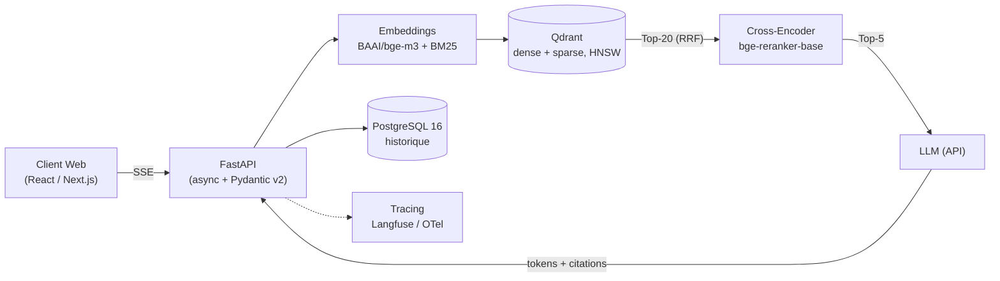

# FinRAG-Insight

Moteur RAG hybride pour analystes financiers : interrogation en langage naturel de documents d'enregistrement universels (DEU) du CAC 40, avec réponses en streaming et citations de pages.

## Problème métier

Un analyste buy-side doit parcourir des rapports de 300 à 700 pages pour retrouver endettement net, engagements hors-bilan et risques. Ctrl+F échoue face aux synonymes financiers (« dette nette », « endettement financier net ») et aux tableaux multi-lignes. FinRAG-Insight extrait, synthétise et cite la page source.

## Architecture



**Pipeline d'ingestion (hors ligne) :** PDF -> extraction par page -> chunking hiérarchique (512 tokens, overlap 64, tableaux conservés entiers) -> embeddings -> indexation Qdrant.

## Choix techniques

| Composant | Choix | Justification |
| :--- | :--- | :--- |
| Base vectorielle | Qdrant | Hybride dense + sparse natif, filtrage par société / exercice, HNSW |
| Embeddings | BAAI/bge-m3 (1024 dim) | Multilingue, bon en français |
| Reranker | BAAI/bge-reranker-base | Cross-Encoder : lit question et passage ensemble |
| Backend | FastAPI + Pydantic v2 | Asynchrone, validation stricte |
| Streaming | SSE | Réponse mot par mot, latence perçue réduite |

## Métriques cibles

Mesurées sur un Golden Dataset de 30 à 50 questions.

| Métrique | Cible |
| :--- | :-: |
| Recall@5 (après reranking) | >= 80 % |
| Faithfulness (Ragas) | >= 0.85 |
| Answer Relevance (Ragas) | >= 0.80 |
| Latence premier token | < 800 ms |

## Équipe

| Membre | Rôle |
| :--- | :--- |
| Msalmi Ines | Lead Data / Retrieval |
| Chiheb Aouadi | Lead Backend / MLOps |
| Semah Yakoubi | Lead Frontend / Infra |

## Structure du dépôt

```
data/raw/        corpus (PDF non versionnés, voir data/raw/README.md)
docs/            fiche de cadrage, backlog MoSCoW
src/             ingestion, retrieval, api
tests/           tests Pytest
docker-compose.yml   Qdrant + PostgreSQL
```

## Démarrage rapide

```bash
python3 -m venv .venv && source .venv/bin/activate
cp .env.example .env        # puis renseigner POSTGRES_PASSWORD
docker compose up -d
curl http://localhost:6333/healthz
```

Dashboard Qdrant : http://localhost:6333/dashboard

## Documentation

- [Fiche de cadrage](docs/fiche_cadrage_projet.md)
- [Backlog MoSCoW](docs/matrice_moscow_backlog.md)
- [Sources du corpus](data/raw/README.md)
